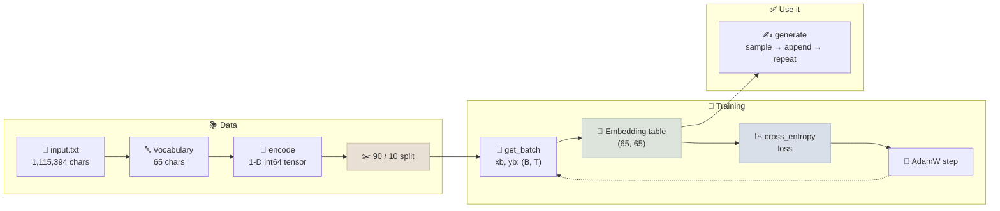
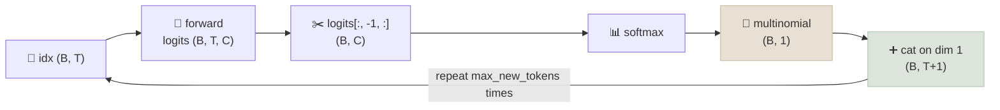

# Primer: The Bigram Language Model, Visualized

The smallest language model that still trains end to end: one 65 × 65 lookup table that reads the current character and scores every possible next character. It is the warm-up build in Andrej Karpathy's [*Let's build GPT*](https://www.youtube.com/watch?v=kCc8FmEb1nY) lecture (2023), and every piece of its pipeline carries over unchanged to the GPT in the next chapter.

```objectives
time: 60 min (35 min of video + the lab)
outcomes:
  - Build a character-level tokenizer and a 90/10 train/validation split for Tiny Shakespeare
  - Explain how one (B, T) batch of inputs and its shifted targets packs B × T next-token examples
  - Trace the bigram forward pass, from (B, T) ids through the (65, 65) embedding table to (B, T, C) logits and a cross-entropy loss
  - Predict the loss of an untrained model (≈ ln 65 ≈ 4.17) and explain why a random table starts higher
  - Write the generate loop (last time step, softmax, multinomial, concatenate) and say what a bigram cannot learn
prerequisites:
  - "[Probability & Information Theory](../../02-Math-for-ML/Notes/02-Probability-and-Information-Theory.mdx) - softmax and cross-entropy"
  - "[Tokenization](../../03-Foundation-Models/Notes/02-Tokenization.mdx) - text to integer ids"
  - "[Training Loop From Scratch](../../06-PyTorch/Notes/03-Training-Loop-From-Scratch.mdx) - forward, loss, backward, step"
```

<div class="audience-biz" markdown="1">

**In short:** before building a GPT, it helps to build the dumbest model that works. A bigram model guesses the next letter from the current letter only, using a table of 4,225 learned numbers. It trains in seconds and its output looks like a play in outline, with names, line breaks and word-shaped chunks, but none of the words are real. Every step that makes it work (preparing text, batching, measuring error, sampling) is the same step a GPT uses. What a GPT adds is a way for each position to read the positions before it.

</div>

## How to Use This Primer

This page follows the bigram section of the lecture, **7:52 to 42:13**. The interactive lab below plays the video and redraws its tensors as it goes: the dataset as a 1-D tensor, the (4, 8) batches, the embedding table, the loss and a live training run. It has 22 steps, a paraphrased transcript you can click to jump, and a line-by-line reading of `bigram.py`. If the video cannot be embedded, the transcript drives the lab on its own. Click **Theatre view** to expand the lab over the page so the video and the visuals sit side by side (Esc to return). The narrow inline view stacks them.

```interactive
src: /labs/bigram/index.html
title: Bigram, Visualized
height: 820
caption: "Synced to [Let's build GPT](https://www.youtube.com/watch?v=kCc8FmEb1nY&t=472s) (7:52-42:13). Drag the 3-D stage to orbit it; on the embedding-table step, hover a cell or type a character to inspect its row. The annotated script is [bigram_annotated.py](/labs/bigram/bigram_annotated.py) (code © Andrej Karpathy, MIT License). See [Credits & Attribution](#credits--attribution)."
```

The rest of this page is the same material as reading notes, in the order the lecture builds it.

## The Pipeline at a Glance



## Step 1 - Data and Tokenizer (7:52)

The dataset is Tiny Shakespeare: Shakespeare's works concatenated into one ~1 MB text file of **1,115,394 characters**. The vocabulary is every distinct character, sorted. There are **65**: newline, space, a few punctuation marks, the digit 3, and the upper- and lower-case letters. A character's position in that list is its integer id.

```python
with open('input.txt', 'r', encoding='utf-8') as f:
    text = f.read()

chars = sorted(list(set(text)))
vocab_size = len(chars)                          # 65
stoi = { ch:i for i,ch in enumerate(chars) }
itos = { i:ch for i,ch in enumerate(chars) }
encode = lambda s: [stoi[c] for c in s]          # "hii there" -> [46, 47, 47, 1, 58, 46, 43, 56, 43]
decode = lambda l: ''.join([itos[i] for i in l])
```

A character tokenizer is two lookup tables. Production models use sub-word tokenizers instead: GPT-2's BPE has 50,257 entries and turns `"hii there"` into 3 tokens rather than 9. The trade-off is vocabulary size against sequence length, covered in [Tokenization](../../03-Foundation-Models/Notes/02-Tokenization.mdx). Characters keep the lecture's table small enough to draw.

## Step 2 - One Tensor, Then the Split (13:10)

The whole text is encoded once and wrapped in a 1-D `torch.long` tensor of shape `(1115394,)`. The first 90% (**1,003,854** tokens) trains the model; the last 10% (**111,540**) is held back, so validation loss can show whether the model generalizes or memorizes.

```python
data = torch.tensor(encode(text), dtype=torch.long)
n = int(0.9*len(data))
train_data, val_data = data[:n], data[n:]
```

The split is contiguous and happens on the token stream, before any chunking. [GPT From Scratch: Step by Step](02-GPT-From-Scratch-Step-by-Step.mdx#step-3---split-into-train-and-validation) explains why that order matters once the data is many documents.

## Step 3 - Chunks, Examples and Batches (14:27)

Training never feeds the whole tensor in at once. It samples chunks of `block_size + 1` tokens. A chunk of 9 holds **8 examples**: each prefix predicts the token right after it, so the model sees every context length from 1 to 8.

```python
block_size = 8
x = train_data[:block_size]
y = train_data[1:block_size+1]
for t in range(block_size):
    context, target = x[:t+1], y[t]    # [18] -> 47, [18, 47] -> 56, ...
```

`get_batch` stacks `batch_size` random chunks into a `(B, T)` input `xb` and a `(B, T)` target `yb`, which is the same chunks shifted one position right. With B = 4 and T = 8 that is **32 independent examples** in one tensor pair. The rows never interact; they share a batch only to keep the GPU busy.

```python
def get_batch(split):
    data = train_data if split == 'train' else val_data
    ix = torch.randint(len(data) - block_size, (batch_size,))
    x = torch.stack([data[i:i+block_size] for i in ix])
    y = torch.stack([data[i+1:i+block_size+1] for i in ix])
    return x, y
```

## Step 4 - The Model Is One Table (22:11)

```python
class BigramLanguageModel(nn.Module):
    def __init__(self, vocab_size):
        super().__init__()
        self.token_embedding_table = nn.Embedding(vocab_size, vocab_size)   # (65, 65)

    def forward(self, idx, targets=None):
        logits = self.token_embedding_table(idx)    # (B, T) -> (B, T, C)
        if targets is None:
            return logits, None
        B, T, C = logits.shape
        loss = F.cross_entropy(logits.view(B*T, C), targets.view(B*T))
        return logits, loss
```

- **Row = current character, columns = next character.** Each id in `idx` plucks its row of 65 numbers. Those numbers are used directly as **logits**, the unnormalized scores for the next character. The table's 65 × 65 = **4,225** entries are the whole model.
- **The lookup is indexing, not arithmetic.** It equals `one_hot(idx) @ weight` but is much cheaper, and it adds the channel dimension: `(4, 8)` ids become a `(4, 8, 65)` block of logits.
- **Each position ignores its neighbours.** `logits[b, t]` depends only on `idx[b, t]`. That is what "bigram" means: pairs of adjacent characters, nothing more.
- **The reshape is for PyTorch, not the math.** `F.cross_entropy` wants class scores in dimension 1, so batch and time are merged into 32 rows of 65, and the targets into 32 ids.

## Step 5 - The Loss Before Training (27:20)

Cross-entropy softmaxes each row of logits and takes **−ln** of the probability given to the correct next character, averaged over the 32 rows. A model that spreads probability evenly over 65 characters scores −ln(1/65) ≈ **4.17**. The random table scores about **4.88** in the video: worse than uniform, because random N(0, 1) logits make it confidently wrong. Checking that the first loss is near ln(vocab size) is the cheapest sanity check in any training run, and the GPT chapter repeats it.

## Step 6 - Generate One Token at a Time (28:40)

```python
def generate(self, idx, max_new_tokens):
    for _ in range(max_new_tokens):
        logits, loss = self(idx)               # (B, T, C)
        logits = logits[:, -1, :]              # last time step -> (B, C)
        probs = F.softmax(logits, dim=-1)      # each row sums to 1
        idx_next = torch.multinomial(probs, num_samples=1)   # (B, 1)
        idx = torch.cat((idx, idx_next), dim=1)              # (B, T+1)
    return idx
```



Feeding each sampled token back in as the next input is what **autoregressive** generation means. Sampling with `multinomial` instead of taking the argmax keeps the text varied; argmax tends to loop. The loop runs the model on the whole history even though a bigram reads only the last token. That is deliberate: the same `generate` works unchanged for the GPT, where every earlier position matters. Starting from a single `0` (the newline character), the untrained table produces noise.

## Step 7 - Train, Then Sample Again (34:53)

```python
optimizer = torch.optim.AdamW(m.parameters(), lr=1e-3)
for steps in range(10000):
    xb, yb = get_batch('train')
    logits, loss = m(xb, yb)
    optimizer.zero_grad(set_to_none=True)
    loss.backward()
    optimizer.step()
```

With a batch of 32, the loss falls from about 4.7 to about **2.5** and flattens. Each step only changes rows for characters that appeared in the batch. Over thousands of steps the rows drift toward Shakespeare's real next-character statistics: after training, `q` is followed by `u` almost every time. Sampled text now has the shape of a play, with speaker names, line breaks and word-length chunks, but no real words. About 2.5 is roughly the floor for a model that sees one character of context.

## Step 8 - From Notebook to `bigram.py` (38:00)

The script version puts the hyperparameters at the top (`batch_size = 32`, `block_size = 8`, `max_iters = 3000`, `learning_rate = 1e-2`), moves the model and each batch to the GPU when there is one, and replaces the single noisy batch loss with `estimate_loss()`: the mean over 200 batches for both splits, run under `@torch.no_grad()` with `model.eval()`. Train and validation loss both end near 2.5, so the bigram is too small to overfit. The lab's last tab reads [bigram_annotated.py](/labs/bigram/bigram_annotated.py) line by line.

## Where the Bigram Stops

Every prediction uses exactly one token of context. `First Ci` is followed by the same guess as any other `i`, whatever came before it. The lecture's next section (42:13) lets each position read the positions before it, first by averaging them and then with learned weights, which is self-attention ([Attention Mechanisms](../../03-Foundation-Models/Notes/04-Attention-Mechanisms.mdx)). The data, the batching, the loss, the training loop and the generate loop on this page all stay. Only the model in the middle changes, which is where [GPT From Scratch: Step by Step](02-GPT-From-Scratch-Step-by-Step.mdx) picks up.

## Check Yourself

```quiz
- q: "`xb` has shape (4, 8). How many next-token training examples does the (xb, yb) pair hold?"
  options: ["32", "4", "8", "36"]
  answer: 1
  explain: "Every position in every row is its own example: the context is xb[b, :t+1] and the target is yb[b, t]. That gives B × T = 4 × 8 = 32."
- q: "Before training, a 65-character model reports a loss of 4.17. What does that say about its predictions?"
  options:
    - "It spreads probability almost evenly over the 65 characters"
    - "It is already better than chance"
    - "Its learning rate is too high"
    - "Its targets are not shifted by one"
  answer: 1
  explain: "−ln(1/65) ≈ 4.17 is the loss of a uniform guess. The lecture's random table scores 4.88, a little worse, because random logits put high confidence on wrong characters."
- q: "What shape does `self.token_embedding_table(idx)` return when `idx` is (4, 8)?"
  options: ["(4, 8, 65)", "(32, 65)", "(65, 65)", "(4, 65)"]
  answer: 1
  explain: "Each of the 32 ids is replaced by its 65-long row, adding a channel dimension. The (32, 65) view is made afterwards, only for cross_entropy."
- q: "Why does `generate` keep only `logits[:, -1, :]`?"
  answer: "The forward pass returns a next-token prediction for every position, but only the last position's prediction is for the token that comes next in the sequence. Indexing with -1 also drops the time dimension, giving (B, C) for softmax and multinomial."
- q: "After 10,000 steps the bigram's loss settles near 2.5 and more training does not help. Why?"
  answer: "The model only ever sees one character of context, so the best it can do is learn the true next-character distribution for each single character. 2.5 is roughly the entropy of that distribution on this text. Lowering it needs more context, which is what self-attention adds."
```

## Exercises

```exercise
- title: Count the bigrams
  task: |
    Skip gradient descent: build the table by counting. For every adjacent pair (a, b) in `train_data`, add 1 to `counts[a, b]`, then set each row to `log((counts + 1) / row_sum)`. Compute the validation loss of this table and compare it with the trained model's ~2.5.
  hints:
    - "`torch.zeros(65, 65)` and `counts.index_put_((x, y), torch.ones(len(x)), accumulate=True)` with x = data[:-1], y = data[1:] does it in one line."
  solution: |
    The count table lands at about the same validation loss, close to 2.5. A bigram's maximum-likelihood solution is the table of log conditional frequencies, so gradient descent on the embedding table is learning the same thing, just slowly. The +1 (Laplace smoothing) keeps pairs that never appeared in training from getting probability 0 and an infinite loss.
- title: Temperature and argmax
  task: |
    Change `generate` to divide the logits by a temperature τ before the softmax. Sample 200 characters from the trained table with τ = 0.5, 1.0 and 2.0, and once with `torch.argmax` instead of `multinomial`. Describe each output.
  solution: |
    τ = 0.5 sharpens the distribution: the most common pairs dominate and the text gets more repetitive. τ = 2.0 flattens it toward uniform and the output drifts back toward noise. Argmax is deterministic: from any character it always picks the same successor, so it falls into a short cycle such as "the the" or a run of spaces within a few characters.
- title: Parameter count at other scales
  task: |
    How many parameters does the bigram table have with the GPT-2 tokenizer (vocab 50,257)? Compare that with GPT-2 small's 124M, and say why a word-level or BPE bigram is still a weak model.
  solution: |
    50,257² ≈ 2.53 billion parameters, about 20 times GPT-2 small, and most rows would be nearly empty because most token pairs never appear in the training data. Parameter count is not the bottleneck: the model still sees one token of context. A transformer shares parameters across positions and reads hundreds of tokens of context with far fewer parameters.
```

## Study Notes

- The pipeline is **text → vocab → encode → split → chunk → batch → model → loss → step**, then **generate**. The GPT chapter changes only the model.
- `y` is `x` shifted one position. A (B, T) batch is B × T examples with context lengths 1 to T.
- The bigram model is `nn.Embedding(V, V)`: row = current token, columns = logits for the next token. 65² = 4,225 parameters.
- Logits are `(B, T, C)`. `cross_entropy` needs `(B·T, C)` and `(B·T,)`, hence the `.view`.
- Expected initial loss ≈ ln(V) = 4.17 for V = 65. A random table starts a little higher (4.88 in the video).
- Generate = forward → last step → softmax → multinomial → cat, repeated. The loop is reused unchanged by the GPT.
- The bigram plateaus near 2.5 because it has one token of context. Self-attention is how a model gets more.

## Credits & Attribution

**Thank you to Andrej Karpathy.** This primer exists because of his lecture [*Let's build GPT: from scratch, in code, spelled out*](https://www.youtube.com/watch?v=kCc8FmEb1nY) (2023), part of the free [Neural Networks: Zero to Hero](https://karpathy.ai/zero-to-hero.html) series, and the code he published with it. If this page helps you, watch the full lecture: it goes on to build the complete GPT.

| Material | Source and terms | What LearnGenAI added |
|---|---|---|
| Video | Andrej Karpathy, on YouTube. Played through YouTube's official embedded player; never downloaded or re-hosted. | Timestamps and a paraphrased, clickable transcript (not a copy of the captions) |
| Code (`bigram.py` and the notebook snippets on this page) | © Andrej Karpathy, [karpathy/ng-video-lecture](https://github.com/karpathy/ng-video-lecture), MIT License | Line-by-line annotations; the full MIT notice is kept in [bigram_annotated.py](/labs/bigram/bigram_annotated.py) and in the lab's **Credits** panel |
| Data (Tiny Shakespeare) | Shakespeare's works (public domain), as packaged in [karpathy/char-rnn](https://github.com/karpathy/char-rnn) | - |
| Visualizations, lab, reading notes, quiz and exercises | Original LearnGenAI material | - |

This page is an independent study aid. It is not affiliated with or endorsed by Andrej Karpathy.

## References

- Karpathy, [Let's build GPT: from scratch, in code, spelled out](https://www.youtube.com/watch?v=kCc8FmEb1nY) (2023) - the bigram section runs from 7:52 to 42:13
- Karpathy, [ng-video-lecture](https://github.com/karpathy/ng-video-lecture) (2023) - `bigram.py` and the lecture notebook, MIT licence
- Karpathy, [char-rnn Tiny Shakespeare dataset](https://github.com/karpathy/char-rnn) (2015)
- Shannon, [A Mathematical Theory of Communication](https://people.math.harvard.edu/~ctm/home/text/others/shannon/entropy/entropy.pdf) (1948) - n-gram models of English text
- Bengio et al., [A Neural Probabilistic Language Model](https://www.jmlr.org/papers/volume3/bengio03a/bengio03a.pdf) (2003) - learned embeddings in place of count tables

*Last reviewed: 2026-10*
