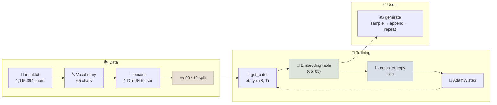
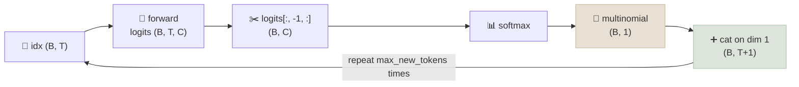
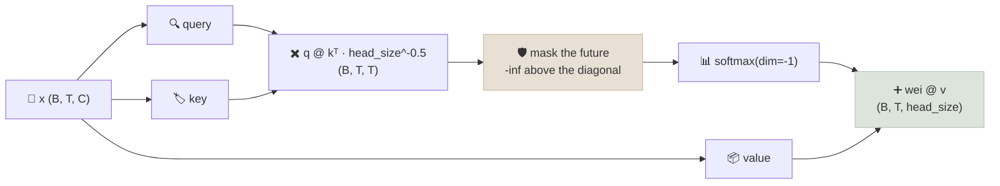
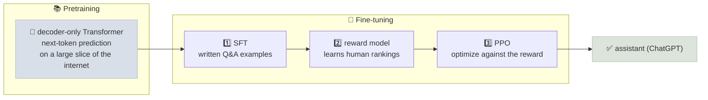

# Primer: Let's Build GPT with Andrej Karpathy, Visualized

A guided, visual companion to all 1 h 56 min of Andrej Karpathy's [*Let's build GPT: from scratch, in code, spelled out*](https://www.youtube.com/watch?v=kCc8FmEb1nY) lecture (2023). It goes from a 65 × 65 bigram lookup table to a 6-layer decoder-only Transformer, then explains how the same architecture becomes ChatGPT.

```objectives
time: 3 hours (116 min of video + the lab)
outcomes:
  - Build a character-level tokenizer, a 90/10 train/validation split and (B, T) batches whose targets are the inputs shifted by one
  - Trace the bigram forward pass from (B, T) ids to (B, T, C) logits and a cross-entropy loss, and predict the loss at initialization (≈ ln 65)
  - Derive masked self-attention step by step, from averaging the past with a lower-triangular matmul to softmax(QKᵀ/√d)V, and state the shape of every tensor
  - Assemble a Transformer block from multi-head attention, a feed-forward layer, residual connections and pre-norm LayerNorm, and explain what each part fixes
  - Explain how a pretrained decoder-only model differs from ChatGPT, and name the three fine-tuning stages that close the gap
prerequisites:
  - "[Probability & Information Theory](../../02-Math-for-ML/Notes/02-Probability-and-Information-Theory.mdx) - softmax and cross-entropy"
  - "[Tokenization](../../03-Foundation-Models/Notes/02-Tokenization.mdx) - text to integer ids"
  - "[Attention Mechanisms](../../03-Foundation-Models/Notes/04-Attention-Mechanisms.mdx) - optional; the lab derives attention from scratch"
  - "[Training Loop From Scratch](../../06-PyTorch/Notes/03-Training-Loop-From-Scratch.mdx) - forward, loss, backward, step"
```

<div class="audience-biz" markdown="1">

**In short:** this page follows one famous lecture that builds a small GPT in about two hours. It starts with the simplest possible model, which guesses the next letter from the current letter alone, and then adds the one idea that makes modern language models work: *attention*, a way for every word to look back at the earlier words that matter to it. Stacked and scaled up, the same model writes convincing fake Shakespeare. The last part explains how the same recipe, at a vastly larger scale and with extra fine-tuning, becomes ChatGPT.

</div>

## How to Use This Primer

The lab below follows the whole lecture in **four parts**, with a short recap card between them:

| Part | Video | What gets built |
|---|---|---|
| 1 · Bigram baseline | 0:00-42:13 | Tokenizer, train/val split, (B, T) batches, a 65 × 65 lookup-table model, loss, sampling, training |
| 2 · Self-attention | 42:13-1:24:25 | A 10-step prelude on tensors and matrices, then averaging the past, the matmul trick, softmax masking, query/key/value, scaling, one head, multi-head |
| 3 · The Transformer block | 1:24:25-1:46:22 | Feed-forward, blocks, residual connections, LayerNorm, scaling up, dropout, encoder vs decoder |
| 4 · nanoGPT & ChatGPT | 1:46:22-1:56:20 | Batched heads in nanoGPT, pretraining at GPT-3 scale, the fine-tuning steps behind ChatGPT |

Click the screenshot to open the lab in a **full-screen pop-up** over this page. It opens with a thank-you card for Andrej Karpathy, with links to the original video and his GitHub repositories. The video plays on one side, synced with a paraphrased transcript you can click to jump through. The other side redraws the tensors in 3-D, with a **Code** / **Line by line** reading of each step. Drag the handle between the two sides to give either one more room (double-click it to reset), and use **Swap sides** to flip them. If the video cannot be embedded, the transcript drives the lab on its own. Close the pop-up with the **✕** in its top-right corner (or Esc) to return to this page.

```interactive
src: /labs/gpt/index.html
title: Let's Build GPT with Andrej Karpathy, Visualized
poster: /labs/gpt/poster-light.jpg
poster_dark: /labs/gpt/poster-dark.jpg
caption: "Synced to [Let's build GPT](https://www.youtube.com/watch?v=kCc8FmEb1nY) (0:00-1:56:20). Drag the 3-D stage to orbit it; most steps have something to hover, click or drag. The annotated bigram script is [bigram_annotated.py](/labs/gpt/bigram_annotated.py) (code © Andrej Karpathy, MIT License). See [Credits & Attribution](#credits--attribution)."
```

The rest of this page is the same material as reading notes, in the order the lecture builds it.

## Part 1 - The Bigram Baseline (0:00-42:13)

The warm-up model is the dumbest one that still trains end to end: one table that reads the current character and scores every possible next character. Every piece of its pipeline carries over unchanged to the GPT.

### The Pipeline at a Glance



### Step 1 - Data and Tokenizer (7:52)

The dataset is Tiny Shakespeare: Shakespeare's works concatenated into one ~1 MB text file of **1,115,394 characters**. The vocabulary is every distinct character, sorted. There are **65**: newline, space, a few punctuation marks, the digit 3, and the upper- and lower-case letters. A character's position in that list is its integer id.

```python
with open('input.txt', 'r', encoding='utf-8') as f:
    text = f.read()

chars = sorted(list(set(text)))
vocab_size = len(chars)                          # 65
stoi = { ch:i for i,ch in enumerate(chars) }
itos = { i:ch for i,ch in enumerate(chars) }
encode = lambda s: [stoi[c] for c in s]          # "hii there" -> [46, 47, 47, 1, 58, 46, 43, 56, 43]
decode = lambda l: ''.join([itos[i] for i in l])
```

A character tokenizer is two lookup tables. Production models use sub-word tokenizers instead: GPT-2's BPE has 50,257 entries and turns `"hii there"` into 3 tokens rather than 9. The trade-off is vocabulary size against sequence length, covered in [Tokenization](../../03-Foundation-Models/Notes/02-Tokenization.mdx). Characters keep the lecture's table small enough to draw.

### Step 2 - One Tensor, Then the Split (13:10)

The whole text is encoded once and wrapped in a 1-D `torch.long` tensor of shape `(1115394,)`. The first 90% (**1,003,854** tokens) trains the model; the last 10% (**111,540**) is held back, so validation loss can show whether the model generalizes or memorizes.

```python
data = torch.tensor(encode(text), dtype=torch.long)
n = int(0.9*len(data))
train_data, val_data = data[:n], data[n:]
```

The split is contiguous and happens on the token stream, before any chunking. [GPT From Scratch: Step by Step](02-GPT-From-Scratch-Step-by-Step.mdx#step-3---split-into-train-and-validation) explains why that order matters once the data is many documents.

### Step 3 - Chunks, Examples and Batches (14:27)

Training never feeds the whole tensor in at once. It samples chunks of `block_size + 1` tokens. A chunk of 9 holds **8 examples**: each prefix predicts the token right after it, so the model sees every context length from 1 to 8.

```python
block_size = 8
x = train_data[:block_size]
y = train_data[1:block_size+1]
for t in range(block_size):
    context, target = x[:t+1], y[t]    # [18] -> 47, [18, 47] -> 56, ...
```

`get_batch` stacks `batch_size` random chunks into a `(B, T)` input `xb` and a `(B, T)` target `yb`, which is the same chunks shifted one position right. With B = 4 and T = 8 that is **32 independent examples** in one tensor pair. The rows never interact; they share a batch only to keep the GPU busy.

```python
def get_batch(split):
    data = train_data if split == 'train' else val_data
    ix = torch.randint(len(data) - block_size, (batch_size,))
    x = torch.stack([data[i:i+block_size] for i in ix])
    y = torch.stack([data[i+1:i+block_size+1] for i in ix])
    return x, y
```

### Step 4 - The Model Is One Table (22:11)

```python
class BigramLanguageModel(nn.Module):
    def __init__(self, vocab_size):
        super().__init__()
        self.token_embedding_table = nn.Embedding(vocab_size, vocab_size)   # (65, 65)

    def forward(self, idx, targets=None):
        logits = self.token_embedding_table(idx)    # (B, T) -> (B, T, C)
        if targets is None:
            return logits, None
        B, T, C = logits.shape
        loss = F.cross_entropy(logits.view(B*T, C), targets.view(B*T))
        return logits, loss
```

- **Row = current character, columns = next character.** Each id in `idx` plucks its row of 65 numbers. Those numbers are used directly as **logits**, the unnormalized scores for the next character. The table's 65 × 65 = **4,225** entries are the whole model.
- **The lookup is indexing, not arithmetic.** It equals `one_hot(idx) @ weight` but is much cheaper, and it adds the channel dimension: `(4, 8)` ids become a `(4, 8, 65)` block of logits.
- **Each position ignores its neighbours.** `logits[b, t]` depends only on `idx[b, t]`. That is what "bigram" means: pairs of adjacent characters, nothing more.
- **The reshape is for PyTorch, not the math.** `F.cross_entropy` wants class scores in dimension 1, so batch and time are merged into 32 rows of 65, and the targets into 32 ids.

### Step 5 - The Loss Before Training (27:20)

Cross-entropy softmaxes each row of logits and takes **−ln** of the probability given to the correct next character, averaged over the 32 rows. A model that spreads probability evenly over 65 characters scores −ln(1/65) ≈ **4.17**. The random table scores about **4.88** in the video: worse than uniform, because random N(0, 1) logits make it confidently wrong. Checking that the first loss is near ln(vocab size) is the cheapest sanity check in any training run, and the GPT chapter repeats it.

### Step 6 - Generate One Token at a Time (28:40)

```python
def generate(self, idx, max_new_tokens):
    for _ in range(max_new_tokens):
        logits, loss = self(idx)               # (B, T, C)
        logits = logits[:, -1, :]              # last time step -> (B, C)
        probs = F.softmax(logits, dim=-1)      # each row sums to 1
        idx_next = torch.multinomial(probs, num_samples=1)   # (B, 1)
        idx = torch.cat((idx, idx_next), dim=1)              # (B, T+1)
    return idx
```



Feeding each sampled token back in as the next input is what **autoregressive** generation means. Sampling with `multinomial` instead of taking the argmax keeps the text varied; argmax tends to loop. The loop runs the model on the whole history even though a bigram reads only the last token. That is deliberate: the same `generate` works unchanged for the GPT, where every earlier position matters. Starting from a single `0` (the newline character), the untrained table produces noise.

### Step 7 - Train, Then Sample Again (34:53)

```python
optimizer = torch.optim.AdamW(m.parameters(), lr=1e-3)
for steps in range(10000):
    xb, yb = get_batch('train')
    logits, loss = m(xb, yb)
    optimizer.zero_grad(set_to_none=True)
    loss.backward()
    optimizer.step()
```

With a batch of 32, the loss falls from about 4.7 to about **2.5** and flattens. Each step only changes rows for characters that appeared in the batch. Over thousands of steps the rows drift toward Shakespeare's real next-character statistics: after training, `q` is followed by `u` almost every time. Sampled text now has the shape of a play, with speaker names, line breaks and word-length chunks, but no real words. About 2.5 is roughly the floor for a model that sees one character of context.

### Step 8 - From Notebook to `bigram.py` (38:00)

The script version puts the hyperparameters at the top (`batch_size = 32`, `block_size = 8`, `max_iters = 3000`, `learning_rate = 1e-2`), moves the model and each batch to the GPU when there is one, and replaces the single noisy batch loss with `estimate_loss()`: the mean over 200 batches for both splits, run under `@torch.no_grad()` with `model.eval()`. Train and validation loss both end near 2.5, so the bigram is too small to overfit. [bigram_annotated.py](/labs/gpt/bigram_annotated.py) reads the script line by line.

### Where the Bigram Stops

Every prediction uses exactly one token of context. `First Ci` is followed by the same guess as any other `i`, whatever came before it. The data, the batching, the loss, the training loop and the generate loop all stay. Only the model in the middle changes, and Part 2 starts changing it.

## Part 2 - Self-Attention (42:13-1:24:25)

The lab opens this part with a 10-step prelude on tensors, matrices, dot products and batched matrix multiplies, the only arithmetic attention needs. Then the lecture builds attention in four versions, each one replacing a piece of the previous one.

### Versions 1-3: Averaging the Past

The simplest way to let token `t` use its past is to average the vectors of tokens `0..t`. A double for-loop does it slowly. A lower-triangular weight matrix does it in one batched multiply, because row `i` of `wei @ x` is a weighted sum of the rows of `x`:

```python
T = 8
tril = torch.tril(torch.ones(T, T))
wei = torch.zeros((T, T))                          # affinities, all equal for now
wei = wei.masked_fill(tril == 0, float('-inf'))    # the future is off limits
wei = F.softmax(wei, dim=-1)                       # each row: 1/(t+1) on tokens 0..t
xbow3 = wei @ x                                    # (T, T) @ (B, T, C) -> (B, T, C)
```

Version 3 matters because of the zeros. They are **affinities**, and once they come from the data instead of being constant, the same mask and softmax still turn them into weights that sum to 1. A second embedding table adds a learned vector per position, `x = tok_emb + pos_emb`, because attention on its own treats its inputs as an unordered set.

### Version 4: Queries, Keys and Values

Every token emits three vectors through three separate linear layers: a **query** (what am I looking for?), a **key** (what do I contain?) and a **value** (what will I share?). The affinity between two tokens is a query dotted with a key.

```python
head_size = 16
key   = nn.Linear(C, head_size, bias=False)
query = nn.Linear(C, head_size, bias=False)
value = nn.Linear(C, head_size, bias=False)
k, q = key(x), query(x)                                # (B, T, 16), no communication yet
wei = q @ k.transpose(-2, -1) * head_size**-0.5        # (B, T, 16) @ (B, 16, T) -> (B, T, T)
wei = wei.masked_fill(tril == 0, float('-inf'))
wei = F.softmax(wei, dim=-1)                           # data-dependent weights
out = wei @ value(x)                                   # (B, T, T) @ (B, T, 16) -> (B, T, 16)
```



### Six Notes on Attention

1. **It is a communication mechanism.** Picture tokens as nodes in a directed graph; each node collects a weighted sum from the nodes that point to it.
2. **It has no notion of space.** Shuffle the inputs and the outputs shuffle with them, which is why positions are encoded into `x`.
3. **Batch elements never talk.** A `(4, 8, 8)` `wei` is four separate attention maps.
4. **Decoder vs encoder.** Keep the triangular mask to predict the next token (a decoder block); delete it to let every token see every other (an encoder block).
5. **Self vs cross.** Self-attention takes queries, keys and values from the same `x`. Cross-attention takes queries from `x` and keys and values from another source, such as an encoder.
6. **Scale by 1/√head_size.** With unit-variance `q` and `k`, the scores have variance ≈ `head_size`. Large scores push softmax toward one-hot, so each token would listen to just one other at initialization.

**Multi-head attention** runs several heads in parallel and concatenates them: 4 heads of 8 dimensions give back the 32-dimensional embedding, as four smaller channels of communication instead of one big one.

## Part 3 - The Transformer Block (1:24:25-1:46:22)

Attention lets tokens gather information. The rest of the block makes that information useful and makes a deep stack trainable.

- **Feed-forward: each token thinks.** A small MLP (`Linear`, `ReLU`, `Linear`) applied to every position separately. Attention is the communication; the MLP is the computation. Inside, it is 4 × `n_embd` wide, the same ratio as the paper's 512 → 2048.
- **Residual connections.** Each sub-layer adds to `x` instead of replacing it: `x = x + self.sa(x)`. Because d(x + f(x))/dx = 1 + f′(x), the gradient has a direct path from the loss to the input, and blocks start near-silent and come online gradually. A projection layer maps each sub-layer's output back into this residual stream.
- **LayerNorm.** BatchNorm standardizes each feature across the batch; LayerNorm standardizes each token's own features. In code it is the mean and variance over dimension 1 instead of 0, with no running buffers. Andrej applies it **before** each sub-layer (pre-norm), as is common today, plus a final `ln_f` before the output layer.
- **Dropout.** During training, a random 20% of activations is zeroed on every step (after the attention weights, after each projection and in the MLP). `model.eval()` turns it off.

```python
class Block(nn.Module):
    """ Transformer block: communication followed by computation """
    def __init__(self, n_embd, n_head):
        super().__init__()
        head_size = n_embd // n_head
        self.sa = MultiHeadAttention(n_head, head_size)
        self.ffwd = FeedForward(n_embd)
        self.ln1 = nn.LayerNorm(n_embd)
        self.ln2 = nn.LayerNorm(n_embd)

    def forward(self, x):
        x = x + self.sa(self.ln1(x))
        x = x + self.ffwd(self.ln2(x))
        return x
```

Scaled up to `batch_size = 64`, `block_size = 256`, `n_embd = 384`, `n_head = 6`, `n_layer = 6` and `dropout = 0.2` (about 10.8M parameters, against the bigram's 4,225), the model trains in about 15 minutes on an A100. Validation loss falls to about **1.48**, and samples read like Shakespeare-shaped nonsense: speaker names, line breaks and plausible-looking words.

What was built is the **decoder** half of the 2017 paper. The paper's encoder-decoder was for translation: the encoder reads the source sentence with no mask, and the decoder adds cross-attention to it. Unconditioned text generation needs neither, and GPT drops them too.

## Part 4 - nanoGPT and ChatGPT (1:46:22-1:56:20)

[nanoGPT](https://github.com/karpathy/nanoGPT)'s `model.py` is the same model with the heads folded into the batch: one linear layer computes q, k and v for every head at once, `view` splits the channels into `(n_head, head_size)`, and `transpose(1, 2)` moves the head axis next to the batch axis so one matmul covers all heads.

```python
q, k, v = self.c_attn(x).split(self.n_embd, dim=2)
k = k.view(B, T, self.n_head, C // self.n_head).transpose(1, 2)   # (B, nh, T, hs)
att = (q @ k.transpose(-2, -1)) * (1.0 / math.sqrt(k.size(-1)))   # (B, nh, T, T)
```

ChatGPT is trained in two stages:



- **Pretraining** is what this lecture does at a vastly larger scale. GPT-3's largest model has 175 billion parameters trained on 300 billion tokens, against about 10 million parameters and about 300 thousand tokens here. The architecture is nearly the same.
- **A pretrained model is a document completer, not an assistant.** Ask it a question and it may continue with more questions, because that is what many documents do.
- **Fine-tuning** closes the gap in three steps from OpenAI's ChatGPT post: supervised fine-tuning on question-answer documents written by people, a reward model trained on human rankings of model answers, and reinforcement learning (PPO) against that reward model. Together the last two are RLHF. The fine-tuning data is not public, so this stage is much harder to reproduce than pretraining.

[GPT From Scratch: Step by Step](02-GPT-From-Scratch-Step-by-Step.mdx) takes the model from Part 3 and turns it into a complete, production-shaped training run.

## Check Yourself

```quiz
- q: "`xb` has shape (4, 8). How many next-token training examples does the (xb, yb) pair hold?"
  options: ["32", "4", "8", "36"]
  answer: 1
  explain: "Every position in every row is its own example: the context is xb[b, :t+1] and the target is yb[b, t]. That gives B × T = 4 × 8 = 32."
- q: "Before training, a 65-character model reports a loss of 4.17. What does that say about its predictions?"
  options:
    - "It spreads probability almost evenly over the 65 characters"
    - "It is already better than chance"
    - "Its learning rate is too high"
    - "Its targets are not shifted by one"
  answer: 1
  explain: "−ln(1/65) ≈ 4.17 is the loss of a uniform guess. The lecture's random table scores 4.88, a little worse, because random logits put high confidence on wrong characters."
- q: "What shape does `self.token_embedding_table(idx)` return when `idx` is (4, 8)?"
  options: ["(4, 8, 65)", "(32, 65)", "(65, 65)", "(4, 65)"]
  answer: 1
  explain: "Each of the 32 ids is replaced by its 65-long row, adding a channel dimension. The (32, 65) view is made afterwards, only for cross_entropy."
- q: "After 10,000 steps the bigram's loss settles near 2.5 and more training does not help. Why?"
  answer: "The model only ever sees one character of context, so the best it can do is learn the true next-character distribution for each single character. 2.5 is roughly the entropy of that distribution on this text. Lowering it needs more context, which is what self-attention adds."
- q: "In one head with `head_size = 16`, `q` and `k` are (4, 8, 16). What is the shape of `wei = q @ k.transpose(-2, -1)`, and what does `wei[b, i, j]` mean?"
  options:
    - "(4, 8, 8): how well token i's query matches token j's key in sequence b"
    - "(4, 16, 16): the covariance of the 16 key dimensions"
    - "(8, 8): one map shared by the whole batch"
    - "(4, 8, 16): the attention output for each token"
  answer: 1
  explain: "transpose(-2, -1) makes k (4, 16, 8), so the batched matmul gives an 8 × 8 grid per sequence. Each cell is one query dotted with one key. Batch elements never mix."
- q: "Why does every Transformer block write `x = x + self.sa(self.ln1(x))` instead of `x = self.sa(x)`?"
  answer: "The addition is a residual connection: the gradient of x + f(x) with respect to x is 1 + f′(x), so the loss always has a direct path back to the input and a deep stack stays trainable. The LayerNorm before the sub-layer (pre-norm) keeps each token's features at mean 0 and variance 1, which steadies the scale of the activations the sub-layer sees."
```

## Exercises

```exercise
- title: Count the bigrams
  task: |
    Skip gradient descent: build the table by counting. For every adjacent pair (a, b) in `train_data`, add 1 to `counts[a, b]`, then set each row to `log((counts + 1) / row_sum)`. Compute the validation loss of this table and compare it with the trained model's ~2.5.
  hints:
    - "`torch.zeros(65, 65)` and `counts.index_put_((x, y), torch.ones(len(x)), accumulate=True)` with x = data[:-1], y = data[1:] does it in one line."
  solution: |
    The count table lands at about the same validation loss, close to 2.5. A bigram's maximum-likelihood solution is the table of log conditional frequencies, so gradient descent on the embedding table is learning the same thing, just slowly. The +1 (Laplace smoothing) keeps pairs that never appeared in training from getting probability 0 and an infinite loss.
- title: Temperature and argmax
  task: |
    Change `generate` to divide the logits by a temperature τ before the softmax. Sample 200 characters from the trained table with τ = 0.5, 1.0 and 2.0, and once with `torch.argmax` instead of `multinomial`. Describe each output.
  solution: |
    τ = 0.5 sharpens the distribution: the most common pairs dominate and the text gets more repetitive. τ = 2.0 flattens it toward uniform and the output drifts back toward noise. Argmax is deterministic: from any character it always picks the same successor, so it falls into a short cycle such as "the the" or a run of spaces within a few characters.
- title: Turn the decoder into an encoder
  task: |
    In the final `gpt.py`, delete the `masked_fill` line in `Head.forward` and retrain for a few hundred steps. What happens to the training loss, and why is the model now useless for generation?
  hints:
    - "Ask what the target at position t is, and whether the model can now see it."
  solution: |
    The loss collapses toward 0 very quickly. Without the mask, position t can attend to position t + 1, which is exactly its target, so the model learns to copy instead of predict. At generation time there is no future token to copy, and the samples are garbage. The mask is what makes a decoder a next-token predictor; an encoder without it is useful when the whole input is known, for example to classify it.
- title: Parameter count at other scales
  task: |
    How many parameters does the bigram table have with the GPT-2 tokenizer (vocab 50,257)? Compare that with GPT-2 small's 124M, and say why a word-level or BPE bigram is still a weak model.
  solution: |
    50,257² ≈ 2.53 billion parameters, about 20 times GPT-2 small, and most rows would be nearly empty because most token pairs never appear in the training data. Parameter count is not the bottleneck: the model still sees one token of context. A transformer shares parameters across positions and reads hundreds of tokens of context with far fewer parameters.
```

## Study Notes

- The pipeline is **text → vocab → encode → split → chunk → batch → model → loss → step**, then **generate**. The GPT chapter changes only the model.
- `y` is `x` shifted one position. A (B, T) batch is B × T examples with context lengths 1 to T.
- The bigram model is `nn.Embedding(V, V)`: row = current token, columns = logits for the next token. 65² = 4,225 parameters.
- Logits are `(B, T, C)`. `cross_entropy` needs `(B·T, C)` and `(B·T,)`, hence the `.view`.
- Expected initial loss ≈ ln(V) = 4.17 for V = 65. A random table starts a little higher (4.88 in the video).
- Generate = forward → last step → softmax → multinomial → cat, repeated. The loop is reused unchanged by the GPT.
- The bigram plateaus near 2.5 because it has one token of context. Self-attention is how a model gets more.
- Attention(Q, K, V) = softmax(QKᵀ / √head_size) V. Shapes: q, k, v (B, T, hs); wei (B, T, T); out (B, T, hs).
- The triangular mask makes a decoder (next-token prediction); without it, an encoder. Cross-attention takes keys and values from another source.
- A block is communication (multi-head attention) followed by computation (a 4×-wide MLP), each wrapped as `x = x + f(ln(x))`.
- Scaled to 6 layers × 384 dims × 6 heads with dropout 0.2, the model reaches a validation loss of about 1.48 in the video.
- ChatGPT = a pretrained decoder-only Transformer + supervised fine-tuning + a reward model + PPO (RLHF).

## Credits & Attribution

**Thank you to Andrej Karpathy.** This primer and its lab exist because of his lecture [*Let's build GPT: from scratch, in code, spelled out*](https://www.youtube.com/watch?v=kCc8FmEb1nY) (2023), part of the free [Neural Networks: Zero to Hero](https://karpathy.ai/zero-to-hero.html) series, and the code he published with it. If this page helps you, watch the full lecture.

| Material | Source and terms | What LearnGenAI added |
|---|---|---|
| Video | Andrej Karpathy, on YouTube. Played through YouTube's official embedded player; never downloaded or re-hosted. | Timestamps and a paraphrased, clickable transcript (not a copy of the captions) |
| Code (`bigram.py`, `gpt.py`, the notebook snippets and the nanoGPT excerpt on this page) | © Andrej Karpathy, [karpathy/ng-video-lecture](https://github.com/karpathy/ng-video-lecture) and [karpathy/nanoGPT](https://github.com/karpathy/nanoGPT), MIT License | Line-by-line annotations; the full MIT notice is kept in [bigram_annotated.py](/labs/gpt/bigram_annotated.py) and in the lab's **Credits** panel |
| Data (Tiny Shakespeare) | Shakespeare's works (public domain), as packaged in [karpathy/char-rnn](https://github.com/karpathy/char-rnn) | - |
| Visualizations, lab, reading notes, quiz and exercises | Original LearnGenAI material | - |

This page is an independent study aid. It is not affiliated with or endorsed by Andrej Karpathy.

## References

- Karpathy, [Let's build GPT: from scratch, in code, spelled out](https://www.youtube.com/watch?v=kCc8FmEb1nY) (2023) - the lecture this page follows, 0:00-1:56:20
- Karpathy, [ng-video-lecture](https://github.com/karpathy/ng-video-lecture) (2023) - `bigram.py`, `gpt.py` and the lecture notebook, MIT licence
- Karpathy, [nanoGPT](https://github.com/karpathy/nanoGPT) (2023) - the repository toured in Part 4, MIT licence
- Vaswani et al., [Attention Is All You Need](https://arxiv.org/abs/1706.03762) (2017) - the Transformer and scaled dot-product attention
- He et al., [Deep Residual Learning for Image Recognition](https://arxiv.org/abs/1512.03385) (2016) - residual connections
- Ba, Kiros & Hinton, [Layer Normalization](https://arxiv.org/abs/1607.06450) (2016)
- Srivastava et al., [Dropout: A Simple Way to Prevent Neural Networks from Overfitting](https://jmlr.org/papers/v15/srivastava14a.html) (2014)
- Brown et al., [Language Models are Few-Shot Learners](https://arxiv.org/abs/2005.14165) (2020) - GPT-3's 175B parameters and 300B training tokens
- Ouyang et al., [Training language models to follow instructions with human feedback](https://arxiv.org/abs/2203.02155) (2022) - SFT, reward model and PPO, the recipe behind ChatGPT
- Karpathy, [char-rnn Tiny Shakespeare dataset](https://github.com/karpathy/char-rnn) (2015)
- Shannon, [A Mathematical Theory of Communication](https://people.math.harvard.edu/~ctm/home/text/others/shannon/entropy/entropy.pdf) (1948) - n-gram models of English text
- Bengio et al., [A Neural Probabilistic Language Model](https://www.jmlr.org/papers/volume3/bengio03a/bengio03a.pdf) (2003) - learned embeddings in place of count tables

*Last reviewed: 2026-10*
