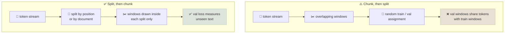
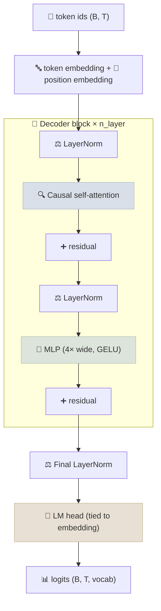
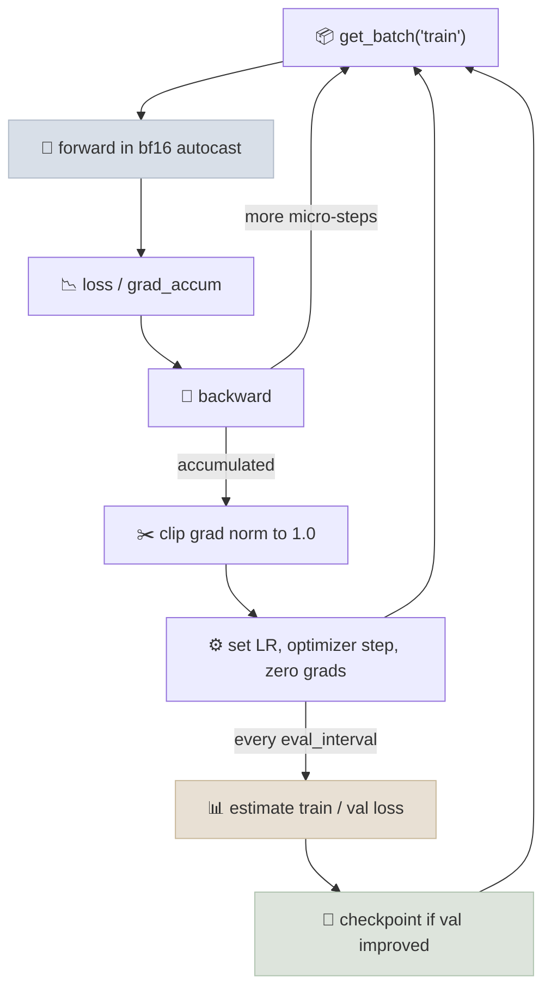

# Building and Training a GPT From Scratch: Step by Step

The complete path from a raw text file to a working decoder-only language model - plan the run, prepare and split the data, build the model, train it, evaluate it and sample from it - with each step in the order it has to happen and the mistake that each step prevents.

```objectives
time: 90 min
outcomes:
  - List the steps of a from-scratch GPT training run in order, and explain why the train/validation split comes after tokenization but before chunking
  - Build the input/target pairs (x, y) from a token stream with a given block size, and compute tokens per optimizer step
  - Implement a GPT-style decoder (embeddings, causal self-attention blocks, tied LM head) and predict its parameter count from its config
  - Write a training loop with AdamW, warmup + cosine decay, gradient accumulation, clipping and periodic validation, and diagnose it from the loss curves
  - Sample text from a trained model with temperature and top-k
prerequisites:
  - "[Tokenization](../../03-Foundation-Models/Notes/02-Tokenization.mdx) - turning text into token ids"
  - "[Transformer Architecture](../../03-Foundation-Models/Notes/03-Architecture.mdx) and [Attention Mechanisms](../../03-Foundation-Models/Notes/04-Attention-Mechanisms.mdx)"
  - "[Training Loop From Scratch](../../06-PyTorch/Notes/03-Training-Loop-From-Scratch.mdx) - forward, loss, backward, step"
  - "[Pretraining Overview](../../07-Pretraining/Notes/01-Training-and-Pretraining.mdx) - the causal LM objective"
  - "[Primer: Bigram Model, Visualized](01-Bigram-Model-Primer.mdx) - the same data pipeline and generate loop on a one-table model"
```

<div class="audience-biz" markdown="1">

**In short:** training a GPT is a fixed recipe. Clean the text, turn it into numbers, set some aside for testing, cut it into fixed-length windows, and repeatedly ask the model to guess the next token. The order matters: hold-out data has to be set aside before the windows are cut, or the test score is inflated by text the model already saw. The same recipe runs from a 10M-parameter toy on a laptop to a 124M-parameter GPT-2 reproduction on one GPU node. Larger runs scale up each step rather than adding new ones.

</div>

## The Pipeline at a Glance

```mermaid
flowchart LR
    subgraph P["📋 Plan"]
        S0["0️⃣ Size the run<br/>params · tokens · compute"]
    end
    subgraph D["📚 Data preparation"]
        S1["1️⃣ Clean & dedup"] --> S2["2️⃣ Tokenize"] --> S3["3️⃣ Train / val split"] --> S4["4️⃣ Chunk into<br/>block_size windows"] --> S5["5️⃣ Batch"]
    end
    subgraph M["🧠 Model & training"]
        S6["6️⃣ Build the GPT"] --> S7["7️⃣ Loss + sanity checks"] --> S8["8️⃣ Optimizer & LR schedule"] --> S9["9️⃣ Training loop"]
    end
    subgraph E["✅ Use it"]
        S10["🔟 Evaluate"] --> S11["💾 Checkpoint"] --> S12["✍️ Generate"]
    end
    S0 --> S1
    S5 --> S6
    S9 --> S10

    style S3 fill:#e8e0d4,stroke:#c8b89a
    style S4 fill:#d8dfe8,stroke:#b0bac8
    style S6 fill:#dde4dc,stroke:#b0c4b0
    style S9 fill:#dde4dc,stroke:#b0c4b0
```



The examples below use two scales. **Toy** is character-level Tiny Shakespeare: about 1.1M characters, a 65-symbol vocabulary and a 10.7M-parameter model, which trains in minutes on one GPU. **Small** is a GPT-2 (124M) reproduction on about 10B tokens of web text with the GPT-2 BPE tokenizer. The code is the same for both; only the config and the data loader change. For a runnable, modernized version (RMSNorm, RoPE, GQA, SwiGLU), see the [GPT From Scratch lab](../../06-PyTorch/CodeLabs/02-GPT-From-Scratch.mdx).

---

## Step 0 - Plan the Run

Decide the scale before you write code, because it determines the tokenizer, the data loader and the hardware.

| Decision | Toy (Tiny Shakespeare) | Small (GPT-2 124M) |
|---|---|---|
| Tokenizer | Characters, vocab 65 | GPT-2 BPE, vocab 50,257 |
| Data | ~1.1M tokens, one file | ~10B tokens, sharded `.npy` files |
| Model | 6 layers, 6 heads, d = 384, T = 256 | 12 layers, 12 heads, d = 768, T = 1024 |
| Parameters | ~10.7M | ~124M |
| Tokens per step | 64 × 256 ≈ 16K | ~0.5M (via gradient accumulation) |
| Compute (C ≈ 6ND) | negligible | 6 × 124M × 10B ≈ 7.4 × 10¹⁸ FLOPs |
| Hardware | 1 GPU, minutes (a laptop CPU works for a smaller preset) | One 8-GPU node, about an hour |

`C ≈ 6ND` (N parameters, D training tokens) is the standard estimate of training FLOPs: about 2ND for the forward pass and 4ND for the backward pass. To turn it into wall-clock time, divide by `GPUs × peak FLOP/s × MFU`. For example, on 8 H100s at ~989 TFLOP/s dense BF16 and 40% MFU, 7.4 × 10¹⁸ / (8 × 9.89 × 10¹⁴ × 0.4) ≈ 2,300 s. Chinchilla's rule of thumb is ~20 tokens per parameter for compute-optimal training (2.5B tokens for 124M), so 10B tokens is deliberately over-trained, which is the usual trade when the model will be used a lot. [Scaling Laws & Compute Budgets](../../07-Pretraining/Notes/04-Scaling-Laws-and-Compute-Budgets.mdx) covers this in depth.

## Step 1 - Clean and Deduplicate the Data

Raw text is collected, filtered for quality and language, stripped of boilerplate, and **deduplicated** (exact and near-duplicate). For a single public-domain file like Tiny Shakespeare there is nothing to do. For web data you start from a curated corpus such as FineWeb-Edu, or run the pipeline in [Data Curation & Mixtures](../../07-Pretraining/Notes/03-Data-Curation-and-Mixtures.mdx).

Two parts of this step protect your evaluation later:

- **Deduplication before the split.** If the same article appears twice and the copies land on different sides of the split, the validation set contains text the model trained on, even with a clean document-level split.
- **Decontamination.** Remove documents that contain your benchmark questions (n-gram overlap against the eval sets), or downstream scores will measure memorization.

## Step 2 - Tokenize

Convert text into a sequence of integer ids.

```python
# Toy: character-level tokenizer
text = open("input.txt", encoding="utf-8").read()
chars = sorted(set(text))                       # 65 unique characters
stoi = {c: i for i, c in enumerate(chars)}
itos = {i: c for c, i in stoi.items()}
encode = lambda s: [stoi[c] for c in s]
decode = lambda ids: "".join(itos[i] for i in ids)

import torch
data = torch.tensor(encode(text), dtype=torch.long)
```

At the small scale you use a trained BPE tokenizer and insert an **end-of-text token between documents**, so the model learns where one document stops and an unrelated one starts:

```python
import numpy as np
import tiktoken

enc = tiktoken.get_encoding("gpt2")
def tokenize_docs(docs):
    ids = []
    for doc in docs:
        ids.extend(enc.encode_ordinary(doc))
        ids.append(enc.eot_token)            # document boundary (id 50256)
    return np.array(ids, dtype=np.uint16)    # 50,257 < 65,536, so uint16 halves the storage
```

Token streams are written to disk once as shards of `uint16` and memory-mapped during training. Tokenizing on the fly in the training loop is a common cause of a GPU waiting on the CPU.

## Step 3 - Split Into Train and Validation

The split happens **after cleaning and tokenization, but before the stream is cut into fixed-size context blocks.**

- **For one continuous text** (like Tiny Shakespeare), a contiguous split is standard: the first 90% of tokens for training, the last 10% for validation.
- **For a corpus of many documents** (GPT-3, Llama-scale pretraining), split at the **document level**. Each whole document goes to exactly one side, so pieces of the same document cannot appear in both sets. With document-level splits, tokenizing first or splitting first gives the same result. What matters is that both happen before chunking.

```python
# Toy: contiguous split on the token stream
n = int(0.9 * len(data))
train_data, val_data = data[:n], data[n:]
```

```python
# Small: document-level split, then tokenize each side into its own stream
import random
random.seed(0)
random.shuffle(docs)                          # docs: cleaned, deduplicated documents
n_val = max(1, int(0.005 * len(docs)))        # 0.5% is plenty at billions of tokens
val_ids = tokenize_docs(docs[:n_val])
train_ids = tokenize_docs(docs[n_val:])
```

**Why the split must come before chunking.** Training windows are usually sampled at random offsets, so they overlap heavily. If you chunk first and then randomly assign windows to train or validation, most validation windows share long runs of tokens with training windows, and validation loss reports memorization rather than generalization. Splitting the stream first makes sure no context window spans the boundary.



## Step 4 - Chunk Into Context Blocks

The model sees fixed-length windows of `block_size` (T) tokens. The target is the same window shifted one token to the left:

```
tokens:  [ 18, 47, 56, 57, 58,  1, 15, 47, 58 ]      block_size T = 8
x:       [ 18, 47, 56, 57, 58,  1, 15, 47 ]
y:       [ 47, 56, 57, 58,  1, 15, 47, 58 ]
```

With a causal mask, every position is its own training example: position t predicts `y[t]` from `x[0..t]`. A window of T tokens therefore gives T predictions, from contexts of length 1 to T. This is also why the model can generate from prompts shorter than T.

There are two ways to draw windows:

- **Random offsets** (nanoGPT style): pick a random start index for each sequence. Simple, but some tokens are seen more often than others.
- **Sequential, non-overlapping** (production style): walk each shard in order, `T + 1` tokens at a time, so every token is seen exactly once per epoch, and the order is shuffled across shards and ranks.

## Step 5 - Batch

Stack B windows into a `(B, T)` batch and move it to the GPU:

```python
def get_batch(split, batch_size=64, block_size=256, device="cuda"):
    data = train_data if split == "train" else val_data
    ix = torch.randint(len(data) - block_size, (batch_size,))
    x = torch.stack([data[i : i + block_size] for i in ix])
    y = torch.stack([data[i + 1 : i + 1 + block_size] for i in ix])
    if device == "cuda":
        x, y = x.pin_memory().to(device, non_blocking=True), y.pin_memory().to(device, non_blocking=True)
    return x, y
```

The number that matters for optimization is **tokens per optimizer step**: `B × T × grad_accum_steps × num_gpus`. GPT-2 small used about 0.5M tokens per step. You usually cannot fit B = 512 sequences of 1,024 tokens on one GPU, so you use a micro-batch that fits (say B = 16) and accumulate gradients over 32 micro-steps (per GPU, divided by the GPU count).

## Step 6 - Build the Model

A GPT is a token embedding plus position embedding, a stack of pre-norm decoder blocks (causal self-attention, then an MLP, each wrapped in a residual connection), a final norm, and a linear head back to the vocabulary.



```python
import math
from dataclasses import dataclass
import torch.nn as nn
import torch.nn.functional as F

@dataclass
class GPTConfig:
    vocab_size: int = 65
    block_size: int = 256
    n_layer: int = 6
    n_head: int = 6
    n_embd: int = 384
    dropout: float = 0.2

class CausalSelfAttention(nn.Module):
    def __init__(self, cfg):
        super().__init__()
        self.n_head, self.dropout = cfg.n_head, cfg.dropout
        self.qkv = nn.Linear(cfg.n_embd, 3 * cfg.n_embd)
        self.proj = nn.Linear(cfg.n_embd, cfg.n_embd)

    def forward(self, x):
        B, T, C = x.shape
        q, k, v = self.qkv(x).split(C, dim=2)
        q, k, v = (t.view(B, T, self.n_head, C // self.n_head).transpose(1, 2) for t in (q, k, v))
        y = F.scaled_dot_product_attention(              # fused kernel, causal mask inside
            q, k, v, is_causal=True, dropout_p=self.dropout if self.training else 0.0)
        return self.proj(y.transpose(1, 2).contiguous().view(B, T, C))

class MLP(nn.Module):
    def __init__(self, cfg):
        super().__init__()
        self.fc = nn.Linear(cfg.n_embd, 4 * cfg.n_embd)
        self.proj = nn.Linear(4 * cfg.n_embd, cfg.n_embd)

    def forward(self, x):
        return self.proj(F.gelu(self.fc(x)))

class Block(nn.Module):
    def __init__(self, cfg):
        super().__init__()
        self.ln1, self.attn = nn.LayerNorm(cfg.n_embd), CausalSelfAttention(cfg)
        self.ln2, self.mlp = nn.LayerNorm(cfg.n_embd), MLP(cfg)
        self.drop = nn.Dropout(cfg.dropout)

    def forward(self, x):
        x = x + self.drop(self.attn(self.ln1(x)))        # pre-norm residual
        x = x + self.drop(self.mlp(self.ln2(x)))
        return x

class GPT(nn.Module):
    def __init__(self, cfg):
        super().__init__()
        self.cfg = cfg
        self.tok_emb = nn.Embedding(cfg.vocab_size, cfg.n_embd)
        self.pos_emb = nn.Embedding(cfg.block_size, cfg.n_embd)
        self.blocks = nn.ModuleList(Block(cfg) for _ in range(cfg.n_layer))
        self.ln_f = nn.LayerNorm(cfg.n_embd)
        self.lm_head = nn.Linear(cfg.n_embd, cfg.vocab_size, bias=False)
        self.lm_head.weight = self.tok_emb.weight         # weight tying
        self.apply(self._init_weights)
        for name, p in self.named_parameters():           # scale residual projections (GPT-2)
            if name.endswith("proj.weight"):
                nn.init.normal_(p, mean=0.0, std=0.02 / math.sqrt(2 * cfg.n_layer))

    def _init_weights(self, m):
        if isinstance(m, (nn.Linear, nn.Embedding)):
            nn.init.normal_(m.weight, mean=0.0, std=0.02)
        if isinstance(m, nn.Linear) and m.bias is not None:
            nn.init.zeros_(m.bias)

    def forward(self, idx, targets=None):
        B, T = idx.shape
        x = self.tok_emb(idx) + self.pos_emb(torch.arange(T, device=idx.device))
        for block in self.blocks:
            x = block(x)
        logits = self.lm_head(self.ln_f(x))
        loss = None
        if targets is not None:
            loss = F.cross_entropy(logits.view(-1, logits.size(-1)), targets.view(-1))
        return logits, loss
```

**Predict the parameter count before you run it.** Each block has about `12 d²` weights (4d² in attention for Q, K, V and the output projection, plus 8d² in the 4× MLP). The embeddings add `V·d + T·d`, and the tied head adds nothing:

- Toy: 12 × 6 × 384² ≈ 10.6M, plus (65 + 256) × 384 ≈ 0.1M, so **≈ 10.7M**
- GPT-2 small: 12 × 12 × 768² ≈ 84.9M, plus 50,257 × 768 ≈ 38.6M, plus 1,024 × 768 ≈ 0.8M, so **≈ 124M**

If `sum(p.numel() for p in model.parameters())` disagrees by more than biases and norms, the config is not what you think it is.

## Step 7 - Loss and Sanity Checks Before Training

Run these three checks before you spend any compute:

1. **Initial loss ≈ ln(vocab_size).** An untrained model should be close to uniform: ln(65) ≈ 4.17 for the toy and ln(50,257) ≈ 10.8 for GPT-2. A much higher value means logits start large and confidently wrong (initialization), and a much lower one usually means targets leak into inputs (an off-by-one in x/y).
2. **Overfit one batch.** Train on a single fixed batch for a few hundred steps. Loss should go to near zero. If it does not, there is a bug in the model or the loop, not a data problem.
3. **Shape-check the targets.** `y[:, t]` must equal `x[:, t + 1]`. Print one decoded pair.

## Step 8 - Optimizer and Learning-Rate Schedule

The standard recipe for GPT-style models is AdamW with β₂ = 0.95, weight decay on matrices only, linear warmup and cosine decay to about 10% of the peak.

```python
decay    = [p for p in model.parameters() if p.dim() >= 2]   # matmul weights, embeddings
no_decay = [p for p in model.parameters() if p.dim() < 2]    # biases, LayerNorm gains
opt = torch.optim.AdamW(
    [{"params": decay, "weight_decay": 0.1}, {"params": no_decay, "weight_decay": 0.0}],
    lr=1e-3, betas=(0.9, 0.95), fused=torch.cuda.is_available())

def lr_at(step, max_lr=1e-3, min_lr=1e-4, warmup=200, max_steps=5000):
    if step < warmup:
        return max_lr * (step + 1) / warmup
    progress = min(1.0, (step - warmup) / max(1, max_steps - warmup))
    return min_lr + 0.5 * (max_lr - min_lr) * (1 + math.cos(math.pi * progress))
```

Typical peak learning rates are about 1e-3 for the 10M toy and 6e-4 for GPT-2 small. Smaller models tolerate larger rates. [Training Stability & Optimizers](../../07-Pretraining/Notes/06-Training-Stability-and-Optimizers.mdx) covers WSD schedules, μP and Muon.

## Step 9 - The Training Loop



```python
import contextlib

device = "cuda" if torch.cuda.is_available() else "cpu"
cfg = GPTConfig(vocab_size=len(chars))
raw_model = GPT(cfg).to(device)
model = torch.compile(raw_model) if device == "cuda" else raw_model
amp = torch.autocast(device_type="cuda", dtype=torch.bfloat16) if device == "cuda" else contextlib.nullcontext()

@torch.no_grad()
def estimate_loss(eval_iters=200):
    model.eval()                                   # disables dropout
    out = {}
    for split in ("train", "val"):
        losses = torch.zeros(eval_iters)
        for k in range(eval_iters):
            x, y = get_batch(split, device=device)
            with amp:
                _, loss = model(x, y)
            losses[k] = loss.item()
        out[split] = losses.mean().item()          # average many batches, not one noisy one
    model.train()
    return out

max_steps, grad_accum, eval_interval, best_val = 5000, 1, 250, float("inf")
for step in range(max_steps):
    for group in opt.param_groups:
        group["lr"] = lr_at(step, max_steps=max_steps)

    if step % eval_interval == 0 or step == max_steps - 1:
        losses = estimate_loss()
        print(f"step {step}: train {losses['train']:.3f}, val {losses['val']:.3f}")
        if losses["val"] < best_val:
            best_val = losses["val"]
            torch.save({"model": raw_model.state_dict(), "optimizer": opt.state_dict(),
                        "step": step, "config": cfg.__dict__, "val_loss": best_val}, "ckpt.pt")

    for _ in range(grad_accum):
        x, y = get_batch("train", device=device)
        with amp:
            _, loss = model(x, y)
        (loss / grad_accum).backward()             # average, not sum, across micro-steps
    torch.nn.utils.clip_grad_norm_(model.parameters(), 1.0)
    opt.step()
    opt.zero_grad(set_to_none=True)
```

Details that are easy to get wrong:

- **Divide the loss by `grad_accum`.** `backward()` adds gradients together, so without the division the effective learning rate is multiplied by the number of micro-steps.
- **bf16 autocast, not fp16.** bf16 has fp32's exponent range, so it needs no gradient scaler. The weights and optimizer state stay in fp32.
- **Save `raw_model.state_dict()`.** A compiled model's keys are prefixed with `_orig_mod.`.
- **Multi-GPU** wraps the model in DDP (or FSDP2 when it no longer fits), launched with `torchrun`. Each rank reads a different part of the data. See [PyTorch for LLMs](../../06-PyTorch/Notes/06-PyTorch-for-LLMs.mdx#multi-gpu-torchrun-ddp-and-fsdp2).

## Step 10 - Evaluate

**Validation loss** is the main signal. Perplexity is `exp(val_loss)`, but only compare it between models that use the same tokenizer, because a loss per character and a loss per BPE token are on different scales. On the toy run, expect validation loss to fall from ~4.2 to about 1.5 at 5,000 steps.

Read the two curves together:

| What you see | Likely cause | What to do |
|---|---|---|
| Loss stays near ln(vocab) | LR far too low, broken x/y shift, or gradients not reaching the weights | Re-run the overfit-one-batch check |
| Loss becomes NaN or jumps up | LR too high, no warmup, fp16 overflow | Lower the LR, add warmup, use bf16, check the clipping |
| Train falls, val rises | Overfitting (common on a 1 MB corpus) | More data, more dropout, a smaller model, or stop at the best val checkpoint |
| Val lower than train | Dropout is active during the train-loss estimate, or the val split is easier | Make sure `estimate_loss` calls `model.eval()` |
| Isolated loss spikes | Bad batches or optimizer instability | See [Training Stability](../../07-Pretraining/Notes/06-Training-Stability-and-Optimizers.mdx) |

At GPT-2 scale, also track a downstream benchmark during training. HellaSwag is the usual one for this size: random chance is 25%, and the original GPT-2 124M scores about 29%. A benchmark tells you whether lower loss is turning into capability, and makes it obvious when a run beats or trails a known reference.

## Step 11 - Checkpoint

Save everything you need to **resume**, not only to run inference: model weights, optimizer state (AdamW's moments are twice the size of the weights), step count, config, the data-loader position and RNG state. Resuming without the optimizer state restarts Adam's moment estimates and usually causes a loss bump. Export inference weights separately as `safetensors`, which stores raw tensors only, unlike a pickled `.pt` file that can run code when loaded.

## Step 12 - Generate

Sampling is autoregressive: feed in the context, take the logits at the last position, sample one token, append it, and repeat. The context is cropped to `block_size`, because learned position embeddings do not exist beyond it.

```python
@torch.no_grad()
def generate(model, idx, max_new_tokens, temperature=1.0, top_k=None):
    model.eval()
    for _ in range(max_new_tokens):
        idx_cond = idx[:, -model.cfg.block_size:]
        logits, _ = model(idx_cond)
        logits = logits[:, -1, :] / temperature            # < 1 sharpens, > 1 flattens
        if top_k is not None:
            v, _ = torch.topk(logits, top_k)
            logits[logits < v[:, [-1]]] = -float("inf")    # keep only the top-k candidates
        next_id = torch.multinomial(F.softmax(logits, dim=-1), num_samples=1)
        idx = torch.cat([idx, next_id], dim=1)
    return idx

start = torch.zeros((1, 1), dtype=torch.long, device=device)   # id 0 is "\n" in the toy vocab
print(decode(generate(raw_model, start, 500, temperature=0.8, top_k=40)[0].tolist()))
```

This loop recomputes the whole context for every new token. Production inference caches keys and values instead; see [KV Cache and Inference Optimization](../../17-Inference-and-Serving/Notes/01-KV-Cache-and-Inference-Optimization.mdx) (later in the course).

## Where to Go Next

The trained model is a **base model**. It continues text but does not follow instructions. From here:

- **Scale up** with the rest of the [Pretraining at Scale](../../07-Pretraining/INDEX.mdx) module: data mixtures, scaling laws, distributed training and profiling.
- **Modernize the architecture** with the [GPT From Scratch lab](../../06-PyTorch/CodeLabs/02-GPT-From-Scratch.mdx): RMSNorm, RoPE, grouped-query attention, SwiGLU.
- **Turn it into an assistant** with [Post-Training & Fine-Tuning](../../09-Post-Training/INDEX.mdx), the next module.

## Check Yourself

```quiz
- q: "You have a corpus of 2 million web documents. Where should the train/validation split happen?"
  options:
    - "After cleaning, deduplication and tokenization, at the document level, before cutting the stream into context blocks"
    - "After chunking, by randomly assigning 10% of the context windows to validation"
    - "Before cleaning, so that the validation set reflects raw web data"
    - "After training, by holding out the windows with the highest loss"
  answer: 1
  explain: "Split whole documents before chunking. Random windows overlap, so assigning windows to train or val after chunking puts the same text on both sides, and validation loss then measures memorization. Dedup has to come first too, or duplicate copies of a document leak across the split."
- q: "With block_size = 8, how many next-token predictions does one (x, y) window train on?"
  options: ["8", "1", "7", "64"]
  answer: 1
  explain: "With a causal mask every position predicts its own next token from the prefix before it, so a window of T tokens gives T predictions, with context lengths 1 to T."
- q: "Your first logged loss on a GPT-2-tokenized dataset is 10.9. What does that tell you?"
  options:
    - "Initialization looks right: ln(50,257) ≈ 10.8, a near-uniform prediction"
    - "The learning rate is too high"
    - "The model is already overfitting"
    - "The x/y shift is off by one"
  answer: 1
- q: "You raise grad_accum from 1 to 8 but forget to divide the loss by 8. What changes?"
  options:
    - "Gradients are 8× too large, so the effective learning rate is 8× higher, partly hidden by gradient clipping"
    - "Nothing, because AdamW normalizes the gradients"
    - "Training becomes 8× slower but otherwise identical"
    - "The model sees 8× fewer tokens per step"
  answer: 1
  explain: "backward() adds gradients across micro-steps. Adam's per-parameter normalization cancels much of a constant scale, but clipping and weight decay interact with it, so the run no longer matches the configuration you intended. Always average across micro-steps."
- q: "Why does generate() crop the context to the last block_size tokens?"
  answer: "The model has learned position embeddings only for positions 0 to block_size - 1, and attention was trained only on windows of that length. Positions beyond that have no embedding (an index error), and even with relative positions such as RoPE, quality degrades past the trained length unless the context is extended."
```

## Exercises

```exercise
- title: Measure the leak
  task: |
    On Tiny Shakespeare, build two validation sets: (a) the contiguous last 10% of tokens, and (b) 10% of randomly assigned windows drawn from random offsets over the whole stream, with training windows drawn from the rest. Train the same toy model for 2,000 steps with each split and compare the gap between train and validation loss.
  hints:
    - "Draw training windows only from start indices that you assigned to train, but notice that neighbouring start indices share T - 1 tokens."
  solution: |
    With the random-window split, validation loss closely follows training loss and can look better than it is, because almost every validation window overlaps several training windows by up to T - 1 tokens. With the contiguous split, a train/val gap opens once the model starts to memorize. Only the contiguous split detects overfitting, which is the job of a validation set.
- title: Count the parameters by hand
  task: |
    For a config with n_layer = 24, n_head = 16, n_embd = 1024, block_size = 1024 and vocab 50,257 (GPT-2 medium), predict the parameter count with weight tying, then check it with the code. How many parameters would untying the LM head add?
  solution: |
    Blocks: 12 × 24 × 1024² ≈ 302M. Token embedding: 50,257 × 1,024 ≈ 51.5M. Position embedding: 1,024 × 1,024 ≈ 1.0M. Total ≈ 354M, plus about 0.3M of biases and LayerNorm parameters, which matches GPT-2 medium's 350M. Untying adds another 51.5M (V × d) for a separate head.
- title: Compute budget for GPT-2 small
  task: |
    Estimate training FLOPs for 124M parameters on 10B tokens with C ≈ 6ND. How long does it take on 8 GPUs at 312 TFLOP/s peak BF16 (A100) and 40% MFU? How many optimizer steps does a batch of 0.5M tokens give, and how many gradient-accumulation micro-steps per GPU at micro-batch 16 × 1,024?
  solution: |
    C ≈ 6 × 1.24 × 10⁸ × 10¹⁰ ≈ 7.4 × 10¹⁸ FLOPs. Throughput: 8 × 3.12 × 10¹⁴ × 0.4 ≈ 1.0 × 10¹⁵ FLOP/s, so about 7,400 s, or roughly 2 hours. Steps: 10¹⁰ / 524,288 ≈ 19,073. Each GPU handles 16 × 1,024 = 16,384 tokens per micro-step, so 524,288 / (8 × 16,384) = 4 micro-steps per GPU per optimizer step.
```

## Study Notes

- The order is fixed: **clean → dedup → tokenize → split → chunk → batch → train**. Splitting after chunking leaks validation text into training.
- Contiguous split for one continuous text; **document-level** split for a corpus. Deduplicate before splitting, and decontaminate against benchmarks.
- `y` is `x` shifted left by one. A window of T tokens gives T predictions.
- Tokens per optimizer step = B × T × grad_accum × GPUs. GPT-2 small used ~0.5M.
- Parameters ≈ 12 · n_layer · d² + V·d (+ T·d for learned positions). Compute ≈ 6ND.
- Before spending compute: initial loss ≈ ln(V), overfit one batch, decode one x/y pair.
- AdamW (β₂ = 0.95, wd 0.1 on matrices), warmup + cosine, clip at 1.0, bf16 autocast, divide the loss by grad_accum.
- Evaluate with `model.eval()` and averaged batches. Keep the best-val checkpoint with optimizer state so you can resume.

## References

- Vaswani et al., [Attention Is All You Need](https://arxiv.org/abs/1706.03762) (2017)
- Radford et al., [Language Models are Unsupervised Multitask Learners (GPT-2)](https://cdn.openai.com/better-language-models/language_models_are_unsupervised_multitask_learners.pdf) (2019)
- Brown et al., [Language Models are Few-Shot Learners (GPT-3)](https://arxiv.org/abs/2005.14165) (2020) - training data, deduplication and the contamination analysis
- Hoffmann et al., [Training Compute-Optimal Large Language Models (Chinchilla)](https://arxiv.org/abs/2203.15556) (2022)
- Loshchilov and Hutter, [Decoupled Weight Decay Regularization (AdamW)](https://arxiv.org/abs/1711.05101) (2019)
- Penedo et al., [The FineWeb Datasets](https://arxiv.org/abs/2406.17557) (2024)
- Karpathy, [Let's build GPT: from scratch, in code, spelled out](https://www.youtube.com/watch?v=kCc8FmEb1nY) (2023), [nanoGPT](https://github.com/karpathy/nanoGPT) and [build-nanogpt](https://github.com/karpathy/build-nanogpt) (2024)
- Karpathy, [Reproducing GPT-2 (124M) in llm.c](https://github.com/karpathy/llm.c/discussions/481) (2024)
- Raschka, [Build a Large Language Model (From Scratch)](https://www.manning.com/books/build-a-large-language-model-from-scratch) (2024)

*Last reviewed: 2026-10*
